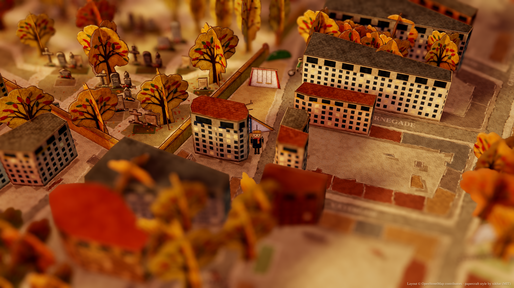

# Nørrebro Explorer

A small walk-around game of Nørrebro, Copenhagen. You pick a character and explore the real neighbourhood: streets,
parks, the lakes, landmarks and local spots, learning to read a map and find your way as you go.

Everything is built from [OpenStreetMap](https://www.openstreetmap.org), so the streets, buildings, parks and trees are
where they really are.

**▶ [Play it in your browser](https://resourcelab.github.io/norrebro-explorer/)** (a computer with a keyboard works best: arrow keys or WASD to walk, Z for the map) · [the flat map style](https://resourcelab.github.io/norrebro-explorer/?style=flat)



**Status (November 2026):** early. The first playable slice is
[`prototypes/assistens-paper-map/`](prototypes/assistens-paper-map/): Assistens Kirkegård and the streets, blocks,
park and playgrounds round it, as a walkable pop-up paper diorama. The OpenStreetMap import for inner Nørrebro works.
The game core, landmarks and the final visual style are still to come (see the roadmap).

## Try it

Play it in your browser at **[resourcelab.github.io/norrebro-explorer/](https://resourcelab.github.io/norrebro-explorer/)**. It is published automatically from `main` (see
`.github/workflows/pages.yml`).

Or download or clone the repo and double-click
`prototypes/assistens-paper-map/dist/assistens-kirkegaard-paper-walk.html`. It is one self-contained file that runs
offline in any modern browser. Arrow keys or WASD to walk, drag to look around.

## Who it is for

1. **Kids and families:** a playful way to understand maps and learn to navigate their own neighbourhood
   (which way is north, reading street names, "find the library", walking a route).
2. **Locals:** Danish first, real local history and spots.
3. **Later, travellers:** type in your Airbnb's address and explore the area around it before you arrive.
   So the world pipeline is built to work for *any* area, not hard-coded to Nørrebro.

## Develop

Needs Node.js 20 or newer. Python 3 is only needed for the optional preview and screenshot tools.

```sh
npm install          # installs every workspace (three.js, esbuild, ESLint)
npm run check        # lint + tests + build, the same as CI
npm run build        # rebuild the prototype's single-file page
npm run dev -w prototypes/assistens-paper-map   # serve it, then open http://localhost:5173/src/
```

Re-import an area from OpenStreetMap: see [`tools/README.md`](tools/README.md).
How the pieces fit together: [`docs/architecture.md`](docs/architecture.md).
How to contribute: [`CONTRIBUTING.md`](CONTRIBUTING.md).

## Repository layout

```
norrebro-explorer/
├── README.md               this file
├── CONTRIBUTING.md         setup, checks, code conventions
├── LICENSE                 MIT (code)
├── NOTICE.md               OpenStreetMap (ODbL), papercraft and three.js credits
├── package.json            npm workspaces + repo scripts (lint, test, build, import)
├── eslint.config.js
├── .github/workflows/      CI (lint, test, build on every push) and publishing the game to GitHub Pages
├── docs/
│   ├── architecture.md     how data, core and style packs fit together
│   └── style-exploration/  mockups and prompts for choosing the look
├── data/                   generated map data (see data/README.md)
│   ├── raw/                OpenStreetMap extracts as downloaded
│   └── world/              the area cut into 100 m tiles
├── tools/                  OSM import and preview scripts (see tools/README.md)
└── prototypes/
    └── assistens-paper-map/  first playable slice: Assistens Kirkegård in papercraft
```

The game is split into a style-free core and swappable styles (papercraft and a flat map so far), inside the
prototype for now: see `prototypes/assistens-paper-map/src/core/` and `src/styles/`. Planned: `data/landmarks/`
(hand-checked landmark texts in Danish and English).

## Decisions so far

| Decision | Choice |
|---|---|
| Backend | Game core only, runs in the browser. No server, accounts or multiplayer. Saves in the browser. |
| Language | Danish first, English second. Simple texts for kids, with a "more" layer for adults. |
| First playable area | Inner Nørrebro: the lakes to Assistens, Nørrebrogade, Sankt Hans Torv, Blågårds Plads, Elmegade (~1 km²). |
| Styles to compare | Papercraft and a flat map run on the same game core (`?style=`); 2D illustrated and pixel art can be added as styles. |
| Build order | Game core first (data, world, movement, journal), style chosen in parallel, then the chosen style. |

## Roadmap

1. **Data pipeline** (done for inner Nørrebro): `tools/import-osm.mjs` turns an OpenStreetMap extract into tiled world
   files in `data/world/`. Works for any area, so the same tool later serves "around my Airbnb".
2. **Landmarks:** `data/landmarks/` with name, short text (kid + adult), category, position and sources, in Danish and
   English. Facts checked against sources before they go in.
3. **Game core:** `core/`, style-free and testable: world chunks, walking and collision, character choice, discovery
   journal, map and compass, guided routes, kid "missions" (e.g. find three playgrounds), saves.
4. **Style exploration:** `docs/style-exploration/`, the same test area drawn in each style. Pick one.
5. **Style pack:** `styles/<chosen>/` renders the core's world. Other styles can be added through the same interface.
6. **Playable v1:** inner Nørrebro, ~25 landmarks, onboarding, character creator, sound.
7. **Later:** the whole district, and "explore around an address" for travellers.

## Credits and licences

Code: MIT ([`LICENSE`](LICENSE)). Map data © OpenStreetMap contributors, ODbL. The papercraft look and its
three.js harness come from [xikhar/papercraft](https://github.com/xikhar/papercraft) (MIT). Details in
[`NOTICE.md`](NOTICE.md).
