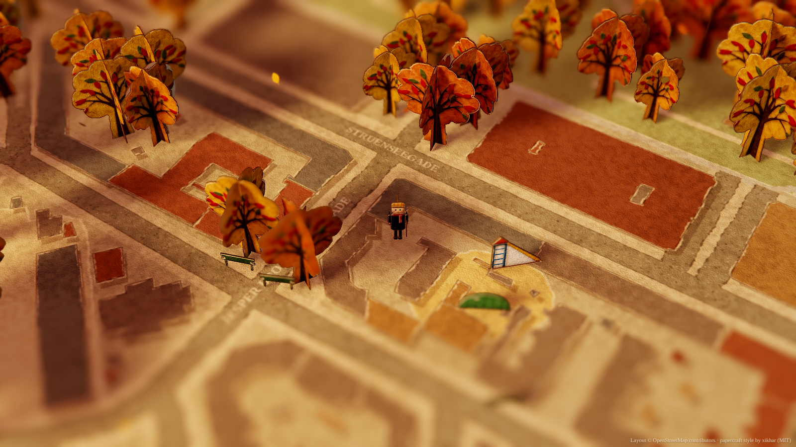

# Assistens Kirkegård — a paper walk

A walkable pop-up paper diorama of Assistens Kirkegård (Nørrebro, Copenhagen) on a November afternoon. Printed card
pieces fold up from a printed ground, seen through a tilt-shift lens. Walk the paths, and stop by a notable grave
(H.C. Andersen, Kierkegaard, Niels Bohr, Natasja…) to see who rests there. Walk out of the gates into the streets
round the walls: Nørrebrogade, Jagtvej, Kapelvej, Hans Tavsens Park and the playgrounds, with a street sign naming the
street you are on.

- **Play it online:** [resourcelab.github.io/norrebro-explorer/](https://resourcelab.github.io/norrebro-explorer/), published from `main`.
- **Open it:** double-click `dist/assistens-kirkegaard-paper-walk.html` (one self-contained file with the whole area
  baked in, works offline).
- **Controls:** arrows / WASD walk · Shift run · Z (or the button) switches between the walking view and the map
  view · click the minimap to switch too · drag to look around · click the scene to fold the world flat and back up.
- **URL options:** `?style=flat` for the flat map style · `?mood=dusk` or `?mood=night` (papercraft) · `?zoom=map` opens
  on the map view · `?capture` hides the overlays (for screenshots; `?capture&hud` keeps them).

## Finding your way

The settings live in `src/config.js` (`TOY`, `WALK`, `ZOOMS`, `NEARBY`), so they are easy to tune; each style's own
look (colours, camera, lens) lives in its `settings.js`.

- **True layout, quicker legs:** every street, block and path is where it really is (1 unit = 5 m). Walking is
  2.5 units/s (12.5 m/s), so crossing a 300 m chunk takes about 25 seconds; Shift runs 2.2× faster.
- **Toy scale:** buildings are true height (3 m storeys), streets are drawn 1.4× wider than mapped, landmarks 1.3×
  taller than life. People, trees and street furniture are larger than life (a real person would be a speck) but stay
  smaller than the buildings round them.
- **Landmarks:** four churches (Hellig Kors, Simeons, Brorsons, Anna) stand on their real footprints with a green copper
  spire, and flags mark Nørrebros Runddel, Folkets Park and Hans Tavsens Park. They stand whatever the distance. The
  towers' exact spot and height are generic, not surveyed. Fingerposts point to the lakes and Superkilen, beyond the
  walkable area, with the distance.
- **Street names:** printed along every named street (repeated along long ones), on corner signs where named streets
  meet, and on the sign in the bottom-left corner for the street you are on.
- **Minimap** (bottom right): north up, about 600 m across, "you are here" arrow, home (for now the start; later the
  player's address), landmarks, arrows on the rim to the lakes and Superkilen, the edge of the walkable area dashed,
  and a compass (N Ø S V) turned the way the 3D view is turned.
- **Two zooms:** close for walking (46 units back, 55° down) and a map view (~400 m across, 72° down, less blur).
- **Near stands up, far lies flat:** pieces within 300 m of the walker stand; further ones fold flat and are hidden,
  and the ground shows them printed (roofs, streets, parks). Blocks are built the first time you come near, a few per
  frame, so the load stays quick and walking never stutters. Beyond the walkable area, a veiled ring of context
  (streets, roofs, the lakes) is printed so the map view never ends in bare paper.
- **Tiles load as you walk:** the map comes in 100 m tiles. Those within 400 m of the walker are loaded and planned,
  and those more than ~520 m away are dropped, with everything on them. The flat style streams this way now; papercraft
  still loads the whole play area up front, because its ground is printed as one sheet.

Status: v0.5 (one coordinate frame, world tiles that stream), 2026-11-25. The first slice of [Nørrebro Explorer](../../README.md).




## Develop

From the repo root run `npm install` once. Then, in this folder:

```sh
npm run dev        # pack the world, serve this folder, then open http://localhost:5173/src/
npm test           # pack the world, then the core, map and wayfinding tests (Node, no browser needed)
npm run build      # pack the world, then dist/index.html + dist/world/ (hosted) and the offline single file
npm run pack-world # ../../data/world (full detail) -> world/ (what the game loads); dev, test and build run it first
npm run capture    # headless overview frames into docs/frames/ (needs Python + Playwright)
```

The dev page loads three.js from a CDN and needs a local server (ES modules and tiles don't load from `file://`).
`dist/index.html` needs a server too (it fetches its tiles); the offline file needs neither.

## How it works

The game and its look are apart. `src/core/` is the game with no graphics: the map, where everything stands, walking,
collision, near and far, where you are. It describes the world as a list of plain **things** (a tree here, a block
there, a church with its tower) and keeps a small **state** (the walker, the cyclists, the zoom). A **style** in
`src/styles/` draws the things and runs the frame loop. The overlays in `src/ui/` read the state and work over any
style. Switch styles with `?style=flat` (the default is papercraft); how to write one is in
[`src/styles/README.md`](src/styles/README.md).

```
              ┌──────────────── src/core (no graphics, tested in Node) ────────────────┐
  data/ ───►  │ map/ ──► plan/ ──► world.js (things) ──► game.js: input, walking,     │
              │                                          collision, near/far, traffic,│
              │                                          places ──► game.state        │
              └───────────────┬──────────────────────────────────────┬────────────────┘
                              │ things, near/far, zoom               │ state
                    ┌─────────┴──────────┐                  ┌────────┴─────────┐
                    │ src/styles/<name>  │  draws, runs     │ src/ui (overlays)│
                    │ papercraft · flat  │  the frame loop  │ minimap, labels  │
                    └────────────────────┘                  └──────────────────┘
```

`src/main.js` opens the world, hands the game to the chosen style (the first tiles load, then the style builds and
starts the loop, calling `game.step(dt)` every frame), then attaches the overlays.

### One frame, tiles, sites

- **One coordinate frame.** Everything is measured from the north-west corner of the imported area (12.541 E,
  55.6965 N), x east, z south: the world tiles, the Assistens plan, the start, the play area. Map data is in metres; the
  game works in units (metres × 0.2). `src/core/geo.js` is the only code that knows about longitude and latitude;
  hand-written places (flags, far places) are given as longitude and latitude and turned into the frame there.
- **Tiles.** `scripts/pack-world.mjs` packs the repo's world tiles (`../../data/world`, full detail) into what the game
  loads (`world/`): de-duplicated, simplified, cut into 100 m tiles with a 30 m margin, plus an overview of the whole
  area for minimaps and the far landscape. `core/world/store.js` loads tiles round the walker and drops far ones;
  `core/world/index.js` indexes what is loaded, so "is there a building here?" looks at a few features, not all.
- **Each tile plans itself.** The neighbourhood's rules (`core/plan/neighbourhood.js`: blocks, street trees,
  playgrounds, racks, benches, corner signs) read only the tile they plan, with the tile's own random stream, so a
  tile always comes out the same, whatever is loaded round it. A thing belongs to the tile it stands on.
- **Sites.** A place with a hand-kept plan in more detail than the tiles, laid over them: today only Assistens
  Kirkegård (`core/sites/assistens/`: walls with gates, path kinds, notable graves, the chapel). Most of Nørrebro needs
  no site; the tiles are enough.
- **Always there.** Churches, flags and fingerposts are made from the overview, so they stand whatever is loaded.

```
src/
├── index.html, styles.css   dev page and overlay styles (the build inlines both)
├── main.js                  entry point
├── config.js                game settings for every style: scale, toy scale, walking, zooms, near/far, play area,
│                            start, home, tile loading
├── data/                    hand-kept data, no logic
│   ├── sites/assistens.js   the cemetery from OpenStreetMap: outline, paths, walls, gates, trees, benches, graves
│   ├── landmarks.js         churches, flags and far places to steer by (longitude, latitude); point playgrounds
│   └── notable-graves.js    who rests where (label text)
├── core/                    the game: no graphics, no style
│   ├── geo.js               the world frame: longitude/latitude ↔ metres ↔ units (the only place that projects)
│   ├── world/               tiles: store (load, unload), features (packed data → units), spatial index, loaders
│   ├── map/                 math, landmarks, the walk rules
│   ├── plan/                where things stand (seeded): per-tile neighbourhood rules; fingerposts and cycle routes
│   ├── sites/               places with their own plan, laid over the tiles: assistens/ (map, plan, things)
│   ├── world.js             the world as things (the contract with the styles): per tile, per site, always there
│   ├── solid.js             how close the walker may come to each kind of thing
│   ├── game.js              the game: world, streaming, step and state, attach(style), game.map for drawing
│   ├── input.js             keyboard → intent (and a scripted input for tests)
│   ├── movement.js          walking: acceleration, turning, sliding along walls
│   ├── colliders.js         collision: the map's rules plus round solid things
│   ├── nearby.js            which things are near the walker
│   ├── traffic.js           the cyclists
│   ├── places.js            which place and street you are at
│   └── random.js            seeded randomness
├── styles/
│   ├── README.md            the style interface
│   ├── index.js             the list of styles (?style=<name>)
│   ├── papercraft/          the pop-up paper diorama
│   │   ├── index.js         the style: harness in drive mode, build, near/far, zoom
│   │   ├── settings.js      palette, camera and lens per zoom, build budget
│   │   ├── world/           printed ground, paper pieces per kind (build.js), presenter (near/far in paper),
│   │   │                    camera, popup, paper-life
│   │   └── pieces/          how each kind looks: trees, graves, walls, chapel, blocks, churches, signs, playground…
│   └── flat/index.js        the flat top-down map (2D canvas)
└── ui/                      overlays for every style: minimap + compass + home, place label, street sign, zoom button
world/                       the packed world (generated by npm run pack-world, not committed)
tests/
├── helpers.mjs              the world from disk, a headless game with a null style
├── core.test.mjs            the core runs headless: things, collision, walking, near/far, tiles streaming, game runs
├── map.test.mjs             geometry, the world frame, the Assistens plan against the tiles, the index, reachability
└── wayfinding.test.mjs      landmarks, corner signs, fingerposts, cyclists, wider streets, the overview
tools/capture.py             headless review screenshots
vendor/papercraft/           the papercraft kit (MIT, see its README for the local changes, including drive mode)
scripts/
├── pack-world.mjs           ../../data/world → world/ (packed tiles + overview)
└── build.mjs                esbuild bundle → dist/ (hosted page + tiles, and the offline single file)
```

## Notes on accuracy

- Placed from OpenStreetMap: the outline, the yellow wall and inner section walls (open at the 13 gates and where paths
  cross), ~75 paths, the chapel's footprint and angle, benches, hedges, notable graves.
- Trees: the 377 mapped trees (mostly the avenues; Poppelalléen as poplars) thinned so crowns don't stack, plus filler
  trees where nothing is mapped. Ordinary grave plots are placed procedurally; only notable graves are at real spots.
- Compressed: 1 world unit = 5 m; paths are drawn wider than life so the toy-scale walker fits.
- The chapel is a generic Danish chapel, not a likeness.
- Round the walls (about 860 × 870 m): every street, building footprint, park, pitch and playground from OpenStreetMap.
  Blocks stand up on their real footprints when you are near (courtyards are filled in; height from the mapped storeys,
  else 5–6). Facades, colours and playground equipment are generic.

## Credits

Map data © OpenStreetMap contributors (ODbL). Papercraft style and harness: [xikhar/papercraft](https://github.com/xikhar/papercraft)
(MIT), vendored in `vendor/papercraft/`. three.js (MIT).
