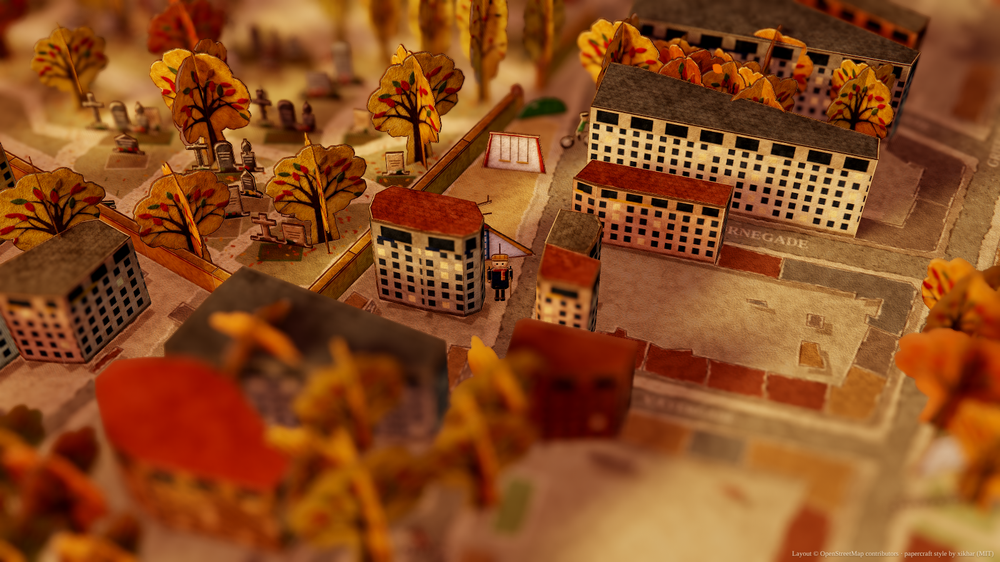

# Assistens Kirkegård — a paper walk

A walkable pop-up paper diorama of Assistens Kirkegård (Nørrebro, Copenhagen) on a November afternoon. Printed card
pieces fold up from a printed ground, seen through a tilt-shift lens. Walk the paths, and stop by a notable grave
(H.C. Andersen, Kierkegaard, Niels Bohr, Natasja…) to see who rests there. Walk out of the gates into the streets
round the walls: Nørrebrogade, Jagtvej, Kapelvej, Hans Tavsens Park and the playgrounds, with a street sign naming the
street you are on.

- **Open it:** double-click `dist/assistens-kirkegaard-paper-walk.html` (one self-contained file, works offline).
- **Controls:** arrows / WASD walk · drag to look around · click to fold the world flat and back up.
- **URL options:** `?mood=dusk` or `?mood=night` · `?capture` hides the overlays (for screenshots).

Status: v0.2, 2026-11-24. The first slice of [Nørrebro Explorer](../../README.md).




## Develop

From the repo root run `npm install` once. Then, in this folder:

```sh
npm run dev        # serve this folder, then open http://localhost:5173/src/
npm test           # map and walking-rule tests (Node, no browser needed)
npm run build      # rebuild dist/assistens-kirkegaard-paper-walk.html
npm run capture    # headless overview frames into docs/frames/ (needs Python + Playwright)
npm run extract-surroundings   # regenerate src/data/surroundings.js from ../../data/world
```

The dev page loads three.js from a CDN and needs a local server (ES modules don't load from `file://`). The built file
has everything inlined and needs neither.

## How it works

`src/main.js` runs the steps in order:

1. **Harness:** `createHarness` from the vendored papercraft kit sets up three.js, the golden light, the tilt-shift
   lens, the hinges every piece stands on, walking and the following camera.
2. **Plan** (`src/plan/`): decide where everything stands. Positions only, seeded, so the same every load.
3. **Ground** (`src/world/ground*.js`): paint the whole ground sheet once: streets, parks, roofs, lawn, plot beds,
   leaves, paths, street names.
4. **Build** (`src/world/build*.js`): put every standing piece on its hinge: chapel, walls, trees, graves, blocks,
   playground kit, the walker.
5. **Walking rules** (`src/map/walk.js`): buildings, water and walls block; gates and path openings let you through.
6. **Life and traffic** (`src/world/life.js`, `traffic.js`): falling leaves, crows, squirrels, cyclists.
7. **Overlays** (`src/ui/`): the grave label and the street sign.

```
src/
├── index.html, styles.css   dev page and overlay styles (the build inlines both)
├── main.js                  entry point: the steps above
├── config.js                scale (1 unit = 5 m), palette, camera, walker start, the paper spec
├── data/                    no logic
│   ├── assistens-osm.js     the cemetery from OpenStreetMap: outline, paths, walls, gates, trees, benches, graves
│   ├── surroundings.js      streets, blocks, parks, playgrounds, trees round the walls (generated)
│   └── notable-graves.js    who rests where (label text)
├── map/                     the map in world units; no randomness
│   ├── math.js              geometry helpers (points, polygons, polylines, hull)
│   ├── units.js             metres → world units
│   ├── cemetery.js          outline, paths, walls and their openings, gates, chapel, sheds
│   ├── neighbourhood.js     play region, streets, areas, buildings, "which building is here?"
│   └── walk.js              where the walker may go
├── plan/                    where every piece stands (positions only)
│   ├── index.js             planWorld(): runs the steps in a fixed order
│   ├── keep-out.js          "keep clear" zones
│   ├── cemetery.js          notable graves, trees, grave plots, benches, lamps
│   └── neighbourhood.js     street trees, playground kit, bike racks, benches, cycle routes
├── pieces/                  how each kind of paper piece looks
│   ├── trees.js  graves.js  walls.js  chapel.js  props.js  critters.js  walker.js
│   ├── buildings.js         apartment blocks folded on their footprints
│   ├── playground.js        swings, slide, climbing dome, seesaw
│   └── street.js            bike rack, cyclists
├── world/                   puts it together
│   ├── ground.js            the printed ground (calls the two layers below)
│   ├── ground-neighbourhood.js, ground-cemetery.js
│   ├── build.js             the standing pieces (calls the two halves below, then adds the walker)
│   ├── build-cemetery.js, build-neighbourhood.js
│   ├── popup.js             places a card on its hinge, facing the walking camera
│   ├── life.js              leaves, crows, squirrels, cloud shadows
│   └── traffic.js           cyclists riding the streets
└── ui/
    ├── overlay.js           shared overlay helpers
    ├── grave-labels.js      "who rests here"
    └── street-sign.js       the street-name sign
tests/map.test.mjs           geometry, gates, buildings, reachability
tools/                       extract-surroundings.py, capture.py
vendor/papercraft/           the papercraft kit (MIT, see its README; one local fix)
scripts/build.mjs            esbuild bundle → dist/
```

## Notes on accuracy

- Placed from OpenStreetMap: the outline, the yellow wall and inner section walls (open at the 13 gates and where paths
  cross), ~75 paths, the chapel's footprint and angle, benches, hedges, notable graves.
- Trees: the 377 mapped trees (mostly the avenues; Poppelalléen as poplars) thinned so crowns don't stack, plus filler
  trees where nothing is mapped. Ordinary grave plots are placed procedurally; only notable graves are at real spots.
- Compressed: 1 world unit = 5 m; paths are drawn wider than life so the toy-scale walker fits.
- The chapel is a generic Danish chapel, not a likeness.
- Round the walls (about 860 × 870 m): every street, building footprint, park, pitch and playground from OpenStreetMap.
  Blocks within ~55 m of the wall stand up on their real footprints (courtyards are filled in; height from the mapped
  storeys, else 5–6); those further out are printed flat as roofs. Facades, colours and playground equipment are generic.

## Credits

Map data © OpenStreetMap contributors (ODbL). Papercraft style and harness: [xikhar/papercraft](https://github.com/xikhar/papercraft)
(MIT), vendored in `vendor/papercraft/`. three.js (MIT).
